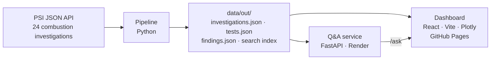

# Flame in Freefall

**NASA's microgravity fire experiments, read for the safety of crews on the Moon and Mars.**

Team **Core-Altai**'s entry for the 2026 NASA Space Apps Challenge, challenge *Flame in Freefall*. We gathered the 24 combustion investigations in NASA's Physical Sciences Informatics (PSI) system and cleaned their test tables into one dataset. We then built a dashboard that shows which experiments tell a future habitat's designers the most about fire risk in their atmosphere.

| | |
|---|---|
| **Live dashboard** | https://khazar451.github.io/NASA-flame-in-freefall/ |
| **Q&A service** | https://nasa-flame-in-freefall.onrender.com/health |
| **Data source** | [NASA Physical Sciences Informatics](https://psi.nasa.gov), Combustion Science |

---

## Why

A flame in microgravity behaves differently from one on Earth. Without buoyancy, hot gas does not rise, so the flame becomes a slow, dim sphere fed only by diffusion and by whatever air the ventilation moves. A material that is safe in a station cabin can burn readily in the oxygen-enriched, low-pressure atmosphere planned for lunar habitats and rovers.

NASA has flown more than a decade of experiments on this, but the results sit in two dozen separate records, each with its own table layout, units and reports. Flame in Freefall puts them side by side. It answers three questions for a chosen habitat atmosphere:

1. **What has been tested?** Every test plotted by oxygen level and pressure, against the cabin, lunar-base and spacesuit atmospheres.
2. **Which experiments matter most here?** A transparent ranking of all 24 investigations, scored for the chosen habitat.
3. **What did NASA find?** Measured results and plain-language answers, each linked to the NASA record or report it came from.

## Features

| View | What it shows |
|---|---|
| **01 Atmosphere map** | 1,553 tests by oxygen level and pressure, marked by fuel type, with the three habitat atmospheres drawn on. Hovering a mark shows how many of its tests burned or went out. Selecting a mark opens the investigation's record, test summary and objectives. |
| **02 Ranking** | All 24 investigations scored for a chosen habitat. The score is a weighted sum of four parts you can see and adjust: atmosphere match (40 %), fuel type (25 %), fire-safety role (25 %) and amount of data (10 %). No model is involved. |
| **03 Test results** | Results the map cannot show: FLEX droplet size at ignition against size at extinction, and burn time by fuel within each experiment. |
| **04 Ask** | Questions in plain English, answered from NASA's records, reports and test tables, with citations to the PSI page or DOI. |

## How it works



1. **Download.** The pipeline lists PSI's Combustion Science investigations through its public JSON API, which needs no login. It then fetches each record, its experimental tables and its documents.
2. **Clean.**
   - Each source table has its own column mapping in [`pipeline/mappings/`](pipeline/mappings/). A mapping turns the table into one shared test format: fuel, oxygen, pressure, flow, outcome, plus family-specific values. It is a short YAML file a domain expert can read and correct.
   - 15 tables are used. 8 are skipped with a written reason, for example when a table gives one row per test day, not per test.
   - Every row records the file and row number it came from.
3. **Tag and extract.**
   - An AI model proposes each investigation's fire-safety role and fuel phase, 48 tags in all. The domain lead reviewed every tag.
   - The AI also extracts 66 key findings from NASA's reports. Code checks each one's supporting quote against the report page before it is kept.
4. **Validate.** The output is checked against the data contract ([`docs/data-contract.md`](docs/data-contract.md)) and against physical sanity ranges.
5. **Serve.**
   - The dashboard is a static site built from the committed output.
   - The Q&A service answers from four kinds of evidence, in this order: experiment overviews, checked findings, the test tables, and document passages found by keyword and meaning-based search.

## Data

| | |
|---|---|
| Investigations | 24 (19 flight, 5 ground studies that reuse flight data) |
| Test rows | 1,828 from 15 tables |
| On the atmosphere map | 1,553 (both oxygen and pressure known) |
| With an air-flow speed | 651 |
| Key findings | 66, each with a checked quote |

**Assumed values are always labelled.** Some tables do not list oxygen or pressure because the tests ran in normal spacecraft cabin air. For these, 21 % oxygen and 1 atm are assumed:

- In the ISS: BASS, BASS-II, SPICE, SAME and SAME-R.
- In a Cygnus cabin: Saffire-I, II and III.

Each such row lists the assumed fields in `assumed` and says so in its note, and the dashboard shows it in the hover text. 812 of the mapped tests carry an assumed value.

**Known limits:**
- 274 inverse-flame tests have no ambient oxygen level, because oxygen flows from the burner into a fuel atmosphere. They are kept but not mapped.
- Eleven investigations have no per-test table. They are ranked on fuel type and role only.
- Burn time depends on the set-up (a droplet, a gas burner, a fabric sheet), so it is compared only within one experiment.

## Repository layout

```
app/        Dashboard (React + Vite + Plotly)          → app/README.md
pipeline/   Data and AI pipeline, Q&A service, tests   → pipeline/README.md
  mappings/   One YAML column mapping per source table
  review/     Domain-lead review sheets, evaluation questions, saved demo answers
data/out/   Pipeline output, the only data in git
docs/       Data contract shared by the pipeline and the dashboard
render.yaml Deployment of the Q&A service
```

## Getting started

### Dashboard

Requires Node 20 or newer.

```bash
cd app
npm install
npm run dev
```

The app reads the committed files in `data/out/`, so it runs without the pipeline.

### Pipeline

Requires Python 3.12.

```bash
python3 -m venv pipeline/.venv && source pipeline/.venv/bin/activate
pip install -r pipeline/requirements.txt
python -m pipeline.run_all --help   # list the steps
python -m pipeline.run_all all      # download from PSI and rebuild data/out/
pytest pipeline                     # tests; no network or API key needed
```

AI steps need a Gemini API key in `pipeline/.env` (see `pipeline/.env.example`). Their results are committed, so a rebuild does not need one.

### Q&A service

```bash
pip install -r pipeline/requirements-api.txt
uvicorn pipeline.api:app --port 8000
```

The service still answers if the AI is unavailable or its quota is used up: Gemini first, then NVIDIA NIM, then answers built from the data alone, still cited. Deployment and settings are in [`pipeline/README.md`](pipeline/README.md).

## Use of AI

As the Space Apps rules require, here is where AI is used:

- **In the product:**
  - Google Gemini, with NVIDIA Nemotron as a fallback, drafts the role and fuel tags, extracts key findings from NASA reports, and writes answers on the Ask page.
  - Every tag was reviewed by our domain lead.
  - Every finding's quote is checked against its source by code.
  - Every answer cites the NASA record or report it draws on.
  - The ranking and all charts are plain calculations on NASA's data, with no AI involved.
- **In development:** An AI coding assistant helped write code and documentation. The team reviewed and tested the work.
- **No AI-generated images** are used.

## Team Core-Altai

| Name | Role |
|---|---|
| **Hayrül Nisa Temur** | Domain lead, mechanical engineering: fire-safety focus, review of all AI tags, approval of assumed values |
| **Khazar Abdullayev** | Data and AI pipeline, computer engineering: PSI download, data cleaning, findings, Q&A service |
| **Hamza Öğretmiş** | Dashboard, computer engineering: atmosphere map, ranking, result charts, Ask page, deployment |

## Acknowledgements

All experimental data comes from NASA's [Physical Sciences Informatics](https://psi.nasa.gov) system and the investigators who ran these experiments. Each investigation in the dashboard links to its PSI record and DOI; please cite those when using the data. This project is not affiliated with or endorsed by NASA.
